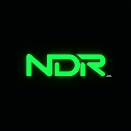
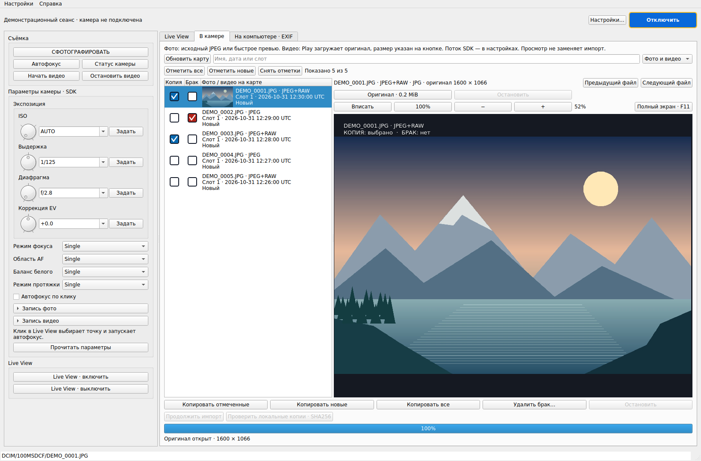

# SonShell Remote

<a href="https://github.com/ndrco"></a>

Настольное приложение для управления камерами Sony под Linux на Qt 6:
Live View, съёмка, отбор фотографий и видео на карте, просмотр и импорт.
Разработка и сопровождение — [NDRco](https://github.com/ndrco).
Основано на [SonShell](https://github.com/goudvuur/sonshell) (Apache-2.0) и
[Sony Camera Remote SDK](https://support.d-imaging.sony.co.jp/app/sdk/en/).

**Статус: в разработке, версия 0.8.3.** Проверенная платформа — Ubuntu 24.04
amd64; аппаратные проверки выполнялись на Sony ILCE-6700. Доступность отдельных
функций зависит от камеры, прошивки и режима съёмки.



*Настоящий интерфейс 0.8.3 на демонстрационных данных, без подключения камеры.
Изображение в просмотрщике — авторская векторная тестовая сцена; личные фотографии
и настройки не использовались.*

Сценарий работы: **съёмка без автоматической передачи RAW → просмотр карты →
отбор/удаление брака → копирование всех, новых или отмеченных файлов**.

- [Сборка и запуск](docs/BUILD.md)
- [Установка на чистую Ubuntu](docs/INSTALL.md)
- [Руководство и клавиши](docs/USER_GUIDE.md)
- [План развития](docs/ROADMAP.md)
- [Архитектура](docs/ARCHITECTURE.md)
- [Проверки](docs/TESTING.md)
- [Изменения](CHANGELOG.md)

## Возможности версии 0.8.3

- Настройки подключения, каталог и параметры превью — в Settings; журнал по запросу.
- Встроенный Live View, съёмка/AF/видео/экспозиция, переподключение.
- Заметная кнопка подключения и подключение при запуске с сохранённым доступом;
  ручное отключение отменяет повторы в текущем сеансе.
- Параметры записи фото и видео, размеры/качество/RAW, стабилизация по
  возможностям камеры; отдельные сворачиваемые разделы и обновление зависимостей.
- ISO, выдержка, диафрагма и EV: крутилки мышью/колесом, список и ручной ввод;
  текущие значения и шаги из камеры. ISO AUTO целиком помещается в поле.
- Галерея JPEG/PNG и RAW, пары RAW+JPEG, миниатюры, поиск, сортировка, фильтры.
- EXIF и встроенные JPEG-превью RAW; полноразмерное проявление RAW пока не реализовано.
- Съёмка без автоматической передачи оригиналов, в том числе после обновления с 0.3.
- Вкладка «В камере»: исходный JPEG по умолчанию, быстрые превью SDK,
  отбор и удаление брака с подтверждением. Видео: Play загружает оригинал и само запускает
  просмотр; RAW — по кнопке. Размер, временный кеш, прогресс и отмена; импорт не отмечается.
- Копирование всех, новых или отмеченных кадров; выбор RAW/JPEG, каталога, прогресс и отмена.
- Учёт завершённых копий для «новых»; полный повторный импорт сохраняет прежние файлы.
- SHA256 при импорте, проверка локальных копий без камеры, сохранение и продолжение
  очереди после обрыва/перезапуска. Недокачанный файл передаётся заново целиком.
- Студийный просмотр 2–10 секунд: сжатое превью или исходный JPEG с карты,
  включая RAW+JPEG; RAW автоматически не загружается. События серии объединяются.
- Отдельное окно просмотра, 100%, масштаб/панорамирование и полный экран.
- Видео на карте: миниатюры, исходное видео через Play, опциональный поток SDK, отбор, удаление и копирование;
  локальная галерея видео с исходными размером и частотой кадров, без JPEG-перекодирования.
  Предпросмотр без звука; для SDK потока нужны входящие TCP от камеры (см. docs/INSTALL.md).
- Полный путь выбранного файла внизу, с выделением и копированием.
- Импорт по локальным датам съёмки: YYYY-MM-DD/Slot_N/исходная иерархия.
- Прозрачные надписи Space/Delete у краёв кадра, в том числе в fullscreen.
- Кнопки соседних файлов и перемотки видео на ±5 секунд, прогресс загрузки
  и отмена доступны в fullscreen.
- Перелистывание ←/→ и Page Up/Page Down в превью и отдельном окне; контрастные отметки.

Справка — меню «Справка» или F1; язык — «Настройки → Язык» (русский/английский,
со следующего запуска). На карте: Space отмечает копию, Delete — брак;
удаление требует отдельного подтверждения. Параметры WB/drive/фокуса и выбор точки
AF мышью доступны по возможностям SDK конкретной камеры. Пользователь подтвердил
исправленный запуск AF в 0.6.2; приёмка новых крутилок остаётся отдельной проверкой.

## Установка

В репозитории публикуются исходники и документация. SDK скачивается отдельно
у Sony и не входит в Git. Использованные версии: SDK 2.02.00, Qt 6.4.2,
C++17. Полные команды для сборки GUI, backend и DEB — в [инструкции](docs/BUILD.md).

```bash
git clone https://github.com/ndrco/SonShell-Remote.git
cd SonShell-Remote
```

Если установочный пакет уже собран, на Ubuntu 24.04 amd64 его можно установить
без компилятора и отдельного SDK. Runtime включён в DEB, зависимости ставит apt:

```bash
sudo apt install ./sonshell-remote_0.8.3-1ubuntu24.04_amd64.deb
```

[Чистая установка, удаление и ограничения платформ](docs/INSTALL.md).

## Ограничения текущей версии

- Другие версии Ubuntu и ARM64 требуют отдельных сборок и проверок.
- RAW показывается через встроенный JPEG; проявление RAW не реализовано.
- Студийный просмотр полного разрешения требует JPEG на карте; RAW-only использует
  сжатое превью. Серии и аппаратный спуск требуют дополнительной приёмки.
- Основной Play видео загружает оригинал целиком в кеш. Прямой SDK-поток доступен
  как опция, но на некоторых роликах ILCE-6700 не выдаёт видеокадры.
- Воспроизведение видео без звука; копирование сохраняет исходный файл целиком.
- Управление одной камерой по IPv4/Wi-Fi/LAN. USB, обнаружение и несколько камер
  в GUI пока не реализованы.

[Возможности и оставшиеся задачи](docs/ROADMAP.md).

## Структура

| Каталог | Назначение |
|---|---|
| gui/ | Qt: интерфейс, сеанс камеры, настройки, изображения |
| src/ | SonShell CLI и SDK |
| cmake/ | Сборка backend и размещение runtime SDK |
| tests/ | Проверки без физической камеры |
| docs/ | Документация и план развития |
| docs/upstream/ | Оригинальная документация SonShell |
| scripts/, tools/, config/ | Унаследованные hooks, генераторы и примеры |

Неофициальный проект. Доступность команд зависит от модели, прошивки, режима
камеры и версии SDK. Реальные аппаратные проверки указываются отдельно.

История SonShell сохранена до `107f9fa`; исходная лицензия — [Apache-2.0](LICENSE).
Условия Sony SDK действуют отдельно. [Происхождение и сторонние компоненты](docs/THIRD_PARTY.md).
Для участия в разработке см. [CONTRIBUTING.md](CONTRIBUTING.md).
